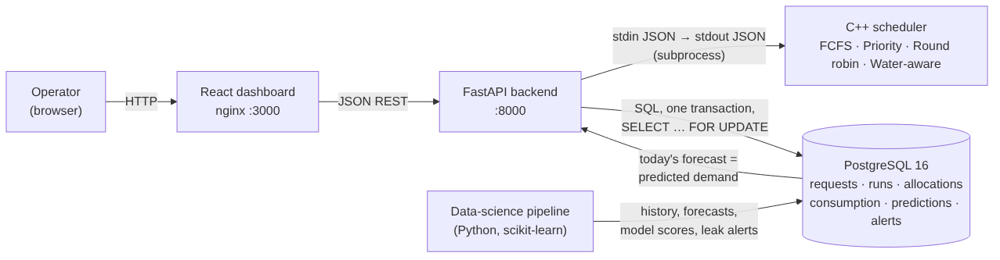
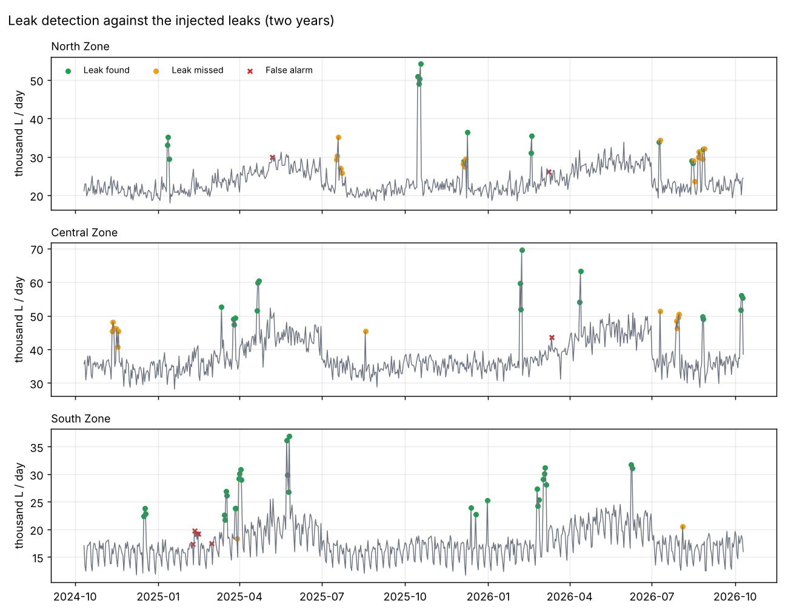
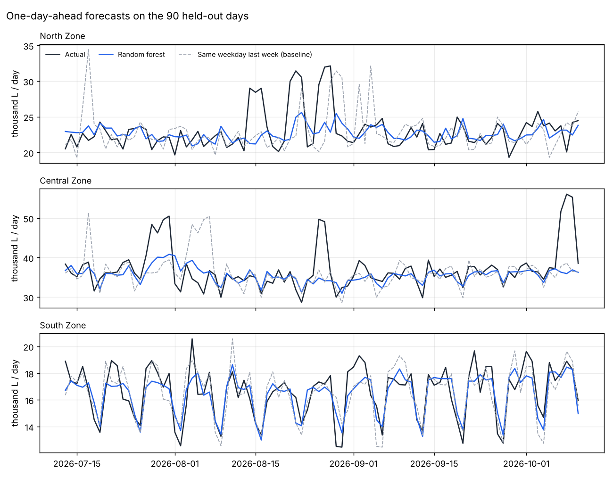

# JalRakshak: Intelligent Water Resource Allocation and Scheduling

**Project-Based Learning, Semester 5. Team HydroLab**

*(Draft. Fill in the team members, guide and institute, and adjust the wording to your department's format.
Every number in this draft comes from the code in this folder and can be reproduced with the commands given.)*

| | |
|---|---|
| Team members | _name, roll number_ × 4 |
| Guide | _name_ |
| Department / Institute | _name_ |
| Academic year | 2026–27 |

---

## Abstract

When a city's reservoir cannot meet every request for water, someone has to decide who gets how much, and
in what order. JalRakshak treats this as an operating-systems scheduling problem: water requests from
hospitals, schools, homes, shops, factories and parks are *processes* competing for one limited *resource*.
We implemented four scheduling rules in C++ (First come first served, non-preemptive Priority, Round robin
with a quantum measured in litres, and our own Water-aware scheduler), a PostgreSQL database that keeps
every allocation consistent even when several operators act at once, a forecasting and leak-detection
pipeline in Python, a FastAPI backend and a React dashboard.

On 600 randomly generated scenarios, no rule is best on every measure. Water-aware is the only rule that never
left any request with nothing under scarcity, and it had the best importance-weighted delivery at moderate
scarcity (0.86). Round robin was the fairest (Jain index 0.94) and had the shortest waits, and Priority
delivered most to important users under severe scarcity (0.64). Water-aware's guarantee floor lets a policy
maker choose between these. A Random forest forecast daily zone demand with a 5.1 % mean absolute percentage
error, against 7.5 % for a "same day last week" baseline. A robust z-score detector found 66 % of injected leak
days with 88 % precision. With database row locks, four simultaneous commits produced exactly one plan;
without them, the same water was allocated twice.

---

## 1. Introduction

### 1.1 Problem

During droughts and summer peaks, the water available in a reservoir is often less than what users ask for.
Allocation is usually done by habit or by "first come, first served". That can leave a hospital waiting behind
a factory, or leave some users with nothing while others are served in full. The decision has to weigh
importance, urgency, fairness between areas and the number of people affected, and it should be explainable
and repeatable.

### 1.2 Why an operating-systems view

An operating system faces the same structure when processes compete for a CPU:

| Operating systems | JalRakshak |
|---|---|
| Process | Water request (who, how many litres, how urgent, by when) |
| CPU / shared resource | Reservoir water and the single supply pipeline |
| Burst time | Litres requested ÷ flow rate (500 L/min) |
| Arrival time, waiting time | Request arrival; minutes until its water starts |
| Scheduling algorithms | FCFS, Priority, Round robin, and Water-aware |
| Time quantum | Round robin quantum = 2,000 L per turn |
| Starvation | A request left with no water at all |
| Critical section, mutex | Committing a plan; `SELECT … FOR UPDATE` row lock |
| Atomicity | One database transaction per plan |

This lets us reuse well-understood algorithms and measures (waiting time, utilisation, fairness) and compare
them on the same inputs.

### 1.3 Objectives

1. Implement the classic scheduling algorithms and a new water-aware algorithm on a common simulation engine.
2. Compare them with clear metrics on many scenarios, and state honestly where each one wins.
3. Store requests and allocations so that concurrent operators can never allocate the same water twice.
4. Forecast demand and detect leaks, and feed the forecast into the scheduler.
5. Provide a dashboard where an operator can compare the rules on live data and apply one.

---

## 2. System design



| Part | Technology | Responsibility |
|---|---|---|
| Scheduler | C++17, no external libraries | Reads a scheduling problem as JSON on stdin, writes the plan and metrics as JSON on stdout |
| Database | PostgreSQL 16 | Organisations, zones, reservoirs, requests, runs, allocations, consumption, forecasts, alerts, accounts, sessions, notifications, issues, audit log; integrity rules |
| Backend | Python, FastAPI | REST API; builds the scheduler input from the database; commits plans in one locked transaction |
| Data science | Python, pandas, scikit-learn | Consumption history, leak detection, demand forecasting, alerts |
| Web app | React 19, bundled with esbuild, served by nginx | Sign-in; **user panel** for organisations (request water, follow requests, report problems, notifications); **admin panel** for the water department (allocation, forecasts, accounts, issues, audit log, settings) |
| Deployment | Docker Compose | One command starts the database, the backend, the ML job and the dashboard |

**Design decision: a separate scheduler program.** The scheduler is a small command-line program with a
JSON contract (`docs/contracts.md`) rather than code inside the backend. It can be tested on its own
(10,353 checks), used by the experiment runner without a database, and replaced without touching anything else.

**Database design.** See `docs/er_diagram.md` for the ER diagram. The schema is in third normal form, and
the database itself enforces the critical rules: the water level must stay between 0 and capacity
(`CHECK`), litres must be positive, priorities and urgencies must be 1 to 5, a deadline must come after
arrival, and a request appears at most once per plan.

### 2.1 Two panels and who can do what

| | User panel (organisations) | Admin panel (water department) |
|---|---|---|
| Who | A hospital, school, colony … signs up; an administrator approves it and sets its priority | Administrators |
| Water | Request water, follow each request, see what it received and when, cancel while waiting | Compare the four rules on all waiting requests, apply one, record requests by phone |
| Problems | Report a leak, no supply, low pressure or water quality; read the reply | Answer reports, set their status |
| People | Profile, password | Approve or reject sign-ups, create accounts, disable, reset passwords |
| Oversight | Alerts for their zone, reservoir status, notifications | Forecasts, alerts, history, **audit log**, settings |

Applying a plan sends each organisation a notification with its result ("approved: 10,000 L", "partly served:
2,400 of 8,000 L (30%)") in the same database transaction as the plan itself.

**Security** (`docs/security.md`): passwords stored as salted PBKDF2-SHA256 hashes (600,000 iterations); random
session tokens stored only as SHA-256 hashes, expiring after 12 hours; five wrong passwords lock an account for
5 minutes; the same error for an unknown email and a wrong password; every endpoint checks the role, and a user's
queries are always filtered to their own organisation. Every change and sign-in is written to an **append-only
audit log**: a PostgreSQL trigger refuses any UPDATE or DELETE on it, and each entry is saved in the same
transaction as the change it records.

---

## 3. The scheduling algorithms

All four share one simulation clock and one supply pipeline: a grant of *L* litres occupies the pipeline for
*L* / 500 minutes. A grant smaller than 20 % of a request is refused rather than handed out (minimum
allocation ratio). Grants are rounded down to whole 0.01 L to match the database's `numeric(12,2)`. The
backend makes the scheduler wait until every pending request has arrived (batch window "all"), because
when an operator clicks *Apply*, all of them are already waiting.

**First come, first served.** Among the requests that have arrived, serve the earliest.

**Priority (non-preemptive).** Serve the highest priority (5 = hospital … 1 = park). A request already being
served is not interrupted.

**Round robin.** Requests wait in a queue; each turn gives a request up to one quantum (2,000 L), after which
it rejoins the back of the queue until it is satisfied or the water runs out. Nobody waits behind a large
request.

**Water-aware (our algorithm).** Whenever the pipeline is free, every waiting request gets a score in [0, 1]:

```
score = 0.30·priority + 0.25·urgency + 0.15·scarcity + 0.15·demand_impact + 0.15·fairness

priority      = priority / 5
urgency       = ½·(urgency / 5) + ½·time_pressure,   time_pressure = how close the deadline is
scarcity      = scarcity_level × (1 − share of the remaining water this request would take)
                scarcity_level = clamp(expected demand / water left, 0, 2) / 2
demand_impact = zone population / largest zone population
fairness      = 1 − share of its requests this zone received in past plans
```

The best score is served next. The weights are configuration, not code. Expected demand is today's ML
forecast when available.

The scarcity factor is per request on purpose. A single scarcity number shared by all requests could never
change their order; ours favours small requests when water is scarce, so more users are served.

**Guarantee floor.** Serving the best-scored request in full can leave the last ones with nothing. So each
grant is capped so that every request still waiting keeps a *floor* (default 30 %) of its request in reserve:

```
cap = max(floor × requested, water_left − floor × litres still requested by the others)
```

A floor of 0 is pure score order (favours priority); a high floor gives nearly equal shares (fairest).

### 3.1 Measures

| Measure | Meaning |
|---|---|
| Average wait | minutes from arrival until a request's water starts |
| Utilisation | water handed out ÷ water available |
| Satisfaction | litres delivered ÷ litres requested |
| Importance-weighted delivery | Σ priority × (received ÷ requested) ÷ Σ priority |
| Fairness (Jain index) | (Σx)² ÷ (n·Σx²), x = received ÷ requested; 1 = everyone got the same share |
| Left with nothing | requests that received no water (starvation) |
| Missed deadlines | served requests whose water finished after their deadline |

---

## 4. Results

### 4.1 The sample scenario

Eight requests ask for 80,000 L; 50,000 L is available. This is the scenario on the dashboard.

| Rule | Avg wait (min) | Fairness | Importance-weighted | Left with nothing | Missed deadlines |
|---|---|---|---|---|---|
| First come, first served | 70 | 0.50 | 0.54 | 4 | 1 |
| Priority | 60 | 0.57 | **0.74** | 3 | **0** |
| Round robin | **29** | **0.91** | 0.71 | **0** | 1 |
| Water-aware | 75 | 0.74 | 0.68 | **0** | **0** |

Water-aware serves the hospital and both housing colonies in full, gives every other requester at least
30 %, and is the only rule with nobody left empty-handed *and* no missed deadline. Priority gives the most to
important users, but three requesters get nothing. Round robin is fairest and fastest, but the hospital gets
only 70 % of what it asked for.

**A bug we found and fixed.** In an earlier version the backend let the scheduler start as soon as the first
request arrived. In the sample, the first arrival is a factory (priority 2): Water-aware gave it the full
20,000 L before the hospital had even arrived, and its importance-weighted delivery fell to 0.56, below FCFS.
Making the scheduler rank all pending requests together fixed this (0.68).

### 4.2 Six hundred random scenarios

`experiments/run_experiments.py` generates 200 random scenarios of 10 requests for each of three scarcity
levels (water ÷ demand = 1.2, 0.75 and 0.5) and runs all four rules on the same scenarios (seed 2026).

| Scenario | Rule | Avg wait | Fairness | Importance-weighted | Left with nothing | Missed deadlines |
|---|---|---|---|---|---|---|
| moderate | FCFS | 42.7 | 0.77 | 0.74 | 2.14 | 1.05 |
| moderate | Priority | 36.8 | 0.73 | 0.85 | 2.46 | 0.91 |
| moderate | Round robin | **13.1** | **0.94** | 0.83 | **0.00** | 2.06 |
| moderate | Water-aware | 48.4 | 0.86 | **0.86** | **0.00** | 1.19 |
| severe | FCFS | 26.1 | 0.52 | 0.50 | 4.63 | 0.38 |
| severe | Priority | 21.1 | 0.53 | **0.64** | 4.46 | **0.29** |
| severe | Round robin | **12.8** | **0.79** | 0.58 | 0.24 | 0.78 |
| severe | Water-aware | 27.7 | 0.74 | 0.56 | **0.00** | 0.36 |

With enough water (1.2) every rule serves everyone in full; they differ only in waiting time.

**What this shows.** Water-aware never starves anyone and has the best importance-weighted delivery at moderate
scarcity. It is not the best rule on every measure: Round robin is fairer and much faster, and under severe
scarcity Priority delivers more to important users. Water-aware is a deliberate middle path between "most
important first" and "everyone equally", and the guarantee floor moves it along that line:

| Floor | Severe: importance-weighted | Severe: fairness | Severe: left with nothing |
|---|---|---|---|
| 0.0 | 0.648 | 0.54 | 4.29 |
| 0.2 | 0.582 | 0.65 | 0.00 |
| **0.3 (default)** | 0.544 | 0.74 | 0.00 |
| 0.5 | 0.500 | 1.00 | 0.00 |

0.2 is the smallest floor that left nobody with nothing; 0.3 was chosen as a balanced default. Choosing the
floor is a policy decision: how much should a park be guaranteed while a hospital waits?
(Full tables: `experiments/README.md`.)

### 4.3 Forecasting and leak detection

Real meter data was not available, so two years of daily consumption per zone were generated with season,
weekday, trend, heat-wave and noise patterns and **injected leaks with known dates** (`ml/README.md`).

**Leak detection.** "Normal" is the median of the same weekday over the previous four weeks; a day is flagged
when it is more than 3 robust standard deviations above normal. The threshold was chosen on a separate
dataset (seed 7), not on the one it is scored on.

| Detector | Precision | Recall | F1 |
|---|---|---|---|
| **Robust z-score (used)** | 0.88 | 0.66 | 0.76 |
| Isolation forest | 1.00 | 0.43 | 0.61 |



**Forecasting.** Each model predicts tomorrow's use per zone from the previous days, the weekday and the
season. Flagged leak days are replaced by their normal value before training. Scores are on the last 90 days,
which were held out.

| Model | Mean absolute error | MAPE |
|---|---|---|
| Same weekday last week (baseline) | 1,849 L | 7.5 % |
| 7-day average (baseline) | 1,735 L | 7.8 % |
| Linear regression | 1,461 L | 6.1 % |
| **Random forest (selected)** | **1,223 L** | **5.1 %** |

Random forest was the most accurate on all five generated datasets we tried. Cleaning the leaks first
improved its error on all five (1,380 L → 1,223 L on the main one).



The selected model's forecast for today, summed over the zones, is passed to the scheduler as expected demand
for the scarcity factor. Leak alerts, low-water alerts (below 30 % of capacity) and "forecast above supply"
alerts appear on the dashboard.

### 4.4 Concurrency

Four clients applied a plan at exactly the same moment (`docs/concurrency.md`):

| | Plans stored | Litres allocated (requests total 80,000 L) |
|---|---|---|
| **With row locks** (real code) | 1 | 80,000 |
| Without row locks | 2 | **160,000** (every request served twice) |

With locks, one commit won and the other three received a clean "no pending requests" response. Without
them, the `CHECK` constraint stopped two of the clients but could not stop the double allocation while water
remained. The row lock makes the operation correct.

---

## 5. Testing

| Suite | What it checks | Result |
|---|---|---|
| C++ scheduler (`make test`) | hand-calculated numbers for every algorithm, input validation, metrics, cent-exact grants, missed deadlines, 1,200 randomised runs checking that no plan ever exceeds the water or a request | 10,353 checks, 0 failures |
| Backend, service layer | locking order, rollback on failure, every algorithm on the sample | pass |
| Backend, real PostgreSQL | commits never over-allocate, concurrent commits allocate once, database refuses a negative level, demo reset | pass |
| Backend, HTTP API | every endpoint, validation (422), errors (400/404/409), settings changes | pass |
| Sign-in and panels | password hashing, identical errors for unknown email and wrong password, lockout after 5 attempts, sign-out and password change end sessions, sign-up → approval → sign-in, role checks on every admin endpoint, users cannot touch other organisations' requests, plan notifications, issue workflow, append-only audit log | 11 tests pass |
| Database upgrade | a real database from an older version is upgraded automatically without losing rows | pass |
| Data science | reproducible data, detector quality, learned models beat baselines, alerts | 10 tests pass |
| Web app | headless browser against the real API and PostgreSQL: sign-in, forced password change, sign-up and approval, user request and issue, applying a plan, notifications, reply to an issue, audit log, sign-out, phone width | pass |

All suites run with `.\scripts\test.ps1` (in Docker) and on every push via GitHub Actions.

---

## 6. Limitations

- The scenarios and the consumption data are synthetic. They show how the methods behave relative to each
  other, not how a real city would fare.
- One reservoir and one pipeline are modelled; real networks have several sources, pipes with limits, and
  pressure zones.
- Deadlines are soft: a late request is still served, and only counted as a missed deadline.
- The weights of the Water-aware score were set by judgement, not learned or agreed with a water authority.
- No password reset by email and no two-factor sign-in; the app should run behind HTTPS before real use.

## 7. Future work

- Real consumption data and weather as a forecasting input.
- Several reservoirs and a network model (which zone can be fed from which source).
- Preemptive Water-aware scheduling: a newly arrived emergency can interrupt a running low-priority grant.
- Choosing weights with stakeholders, or learning them from past decisions.
- Finer roles (operator, viewer), password reset by email, and two-factor sign-in.

## 8. Conclusion

JalRakshak shows that operating-system scheduling ideas carry over to allocating scarce water, and that the
right rule depends on what is valued. Our Water-aware scheduler is the only one of the four that never left
anyone without water under scarcity. It gave the best importance-weighted delivery at moderate scarcity, and
its guarantee floor makes the trade-off between priority and fairness an explicit, tunable policy. The
database's transactional locking keeps allocations correct under concurrent use, which we demonstrated
experimentally. A forecasting model with about 5 % error supplies expected demand, and a leak detector raises
alerts.

## References

1. A. Silberschatz, P. B. Galvin, G. Gagne, *Operating System Concepts*, 10th ed., Wiley, 2018 (CPU scheduling, synchronisation).
2. R. Jain, D. Chiu, W. Hawe, "A Quantitative Measure of Fairness and Discrimination for Resource Allocation in Shared Computer Systems", DEC-TR-301, 1984.
3. PostgreSQL 16 documentation, "Explicit Locking" (row-level locks, `SELECT … FOR UPDATE`).
4. L. Breiman, "Random Forests", *Machine Learning* 45, 2001.
5. F. T. Liu, K. M. Ting, Z.-H. Zhou, "Isolation Forest", IEEE ICDM, 2008.
6. F. Pedregosa et al., "Scikit-learn: Machine Learning in Python", *JMLR* 12, 2011.
