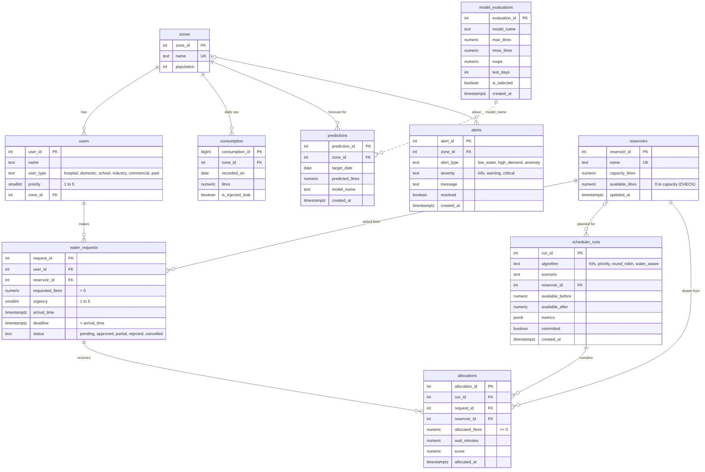
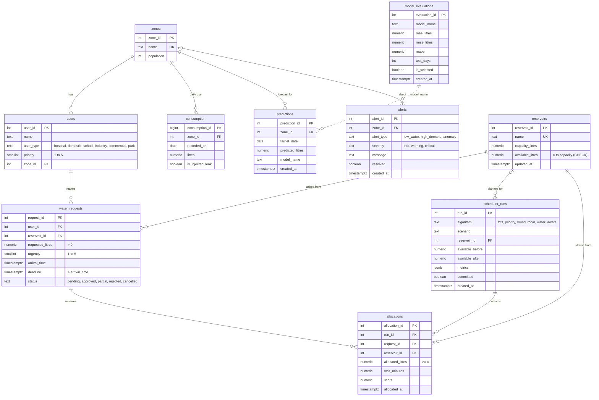

# Database design (ER diagram)

(`er_diagram.svg` is the same picture as a vector file for the report; `er_diagram.mmd` is its Mermaid source,
which GitHub also renders below.)

## Tables

| Table | One row per | Written by |
|---|---|---|
| `zones` | area of the city, with its population | seed data |
| `users` | requester (hospital, school, homes, industry, shop, park) with a priority 1 to 5 | seed data |
| `reservoirs` | water source, with capacity and water available now | seed data, every committed plan |
| `water_requests` | request for litres by a deadline; status pending / approved / partial / rejected | dashboard form, committed plans |
| `scheduler_runs` | applied allocation plan: algorithm, water before and after, metrics (JSON) | `POST /allocate/commit` |
| `allocations` | litres one request received in one run, with wait and score | `POST /allocate/commit` |
| `consumption` | zone's measured use on one day (`is_injected_leak` = ground truth for testing) | ML pipeline |
| `predictions` | forecast of a zone's use on a future day, per model | ML pipeline |
| `model_evaluations` | accuracy of one forecasting model; `is_selected` marks the one in use | ML pipeline |
| `alerts` | leak / rising demand notice; can be marked resolved | ML pipeline, dashboard |

## Rules the database enforces itself

- `reservoirs.available_litres` must stay between 0 and capacity (`CHECK`). Even a buggy program cannot
  hand out water that is not there: the transaction fails and nothing is saved.
- `requested_litres > 0`, `allocated_litres >= 0`, `priority` and `urgency` between 1 and 5, `deadline > arrival_time`.
- `UNIQUE (run_id, request_id)`: a request appears at most once in a plan.
- Foreign keys: no allocation can point at a request, run or reservoir that does not exist.

## Normalisation

The schema is in third normal form: every non-key column depends only on its table's key. For example a
request's priority is not copied into `water_requests`; it is read from the requester in `users`, and a zone's
population lives only in `zones`. `scheduler_runs.metrics` is stored as JSON on purpose: it is a read-only
snapshot of the run's results, never queried column by column.

The dashed link between `model_evaluations` and `predictions` is by `model_name`, not a foreign key: the
pipeline replaces both tables together in one transaction.

